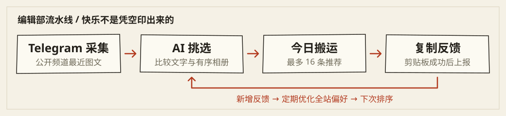

# BanShit · 搬屎日报社

**屎海茫茫，替你淘金。** 一份穿着严肃报纸外套的梗图小报：搬屎工去 Telegram 找素材，AI 值班编辑挑选，你负责把喜欢的揣进剪贴板。

Telegram meme 推荐工具，Go + SQLite + 原生前端。采集公开频道图文，用多模态模型相对排序，并根据复制反馈优化全站共享偏好。前端通过 go:embed 嵌入单个可执行文件，纯 Go SQLite 驱动，无需 Node.js、npm、前端构建或 CGO；支持明暗主题。

## 本期看点 · 功能速览

| 编辑部工位 | 做什么 |
| --- | --- |
| 外勤搬运 | 默认无需 Telegram Token，轮询公开频道最近图文；也可授权自己的 Telegram 账号采集公开频道。 |
| AI 选稿 | 多模态模型比较文字与有序相册，跨批排序后发布最多 16 条推荐，以相对名次选稿。 |
| 今日搬运 | 纯文字、单图、多图都能上版；进入预览框可复制文字、当前图或整组拼图。 |
| 读者来信 | 成功复制后记录反馈，定期优化**全站共享**兴趣提示词；不是每位访客独立推荐。 |
| 轻装开报 | Go + SQLite，单个可执行文件嵌入原生前端；纸面 / 墨色双主题，无需前端构建。 |



> **开报前须知：** 这是最近内容的定时采集，不是完整历史同步；不支持私有频道、视频和动画。需要自行配置支持图像输入的模型，模型请求可能产生费用。内容与复制样本会发送给配置的模型服务。公网部署必须使用 HTTPS，后台仅对可信管理员开放。

## 阅报导航

| 想看什么 | 去哪里 |
| --- | --- |
| 先让报社开门 | [快速启动](#快速启动) · [配置默认值与环境变量](#配置默认值与环境变量) |
| 用容器部署 | [Docker / Compose 部署说明](docs/docker.md) |
| 看懂选稿与反馈 | [工作方式](#工作方式) · [运行状态与复制记录](#运行状态与复制记录) |
| 使用自己的 Telegram 账号 | [Telegram 账号采集](#telegram-账号采集mtproto) |
| 安全上线与备份 | [部署与安全](#部署与安全) · [安全说明](SECURITY.md) · [发布检查清单](docs/releasing.md) |
| 给编辑部添砖加瓦 | [项目结构](#项目结构) · [测试](#测试) · [开发指南](CONTRIBUTING.md) |

项目采用 [MIT 许可证](LICENSE)。第三方依赖及采集内容仍受各自许可证或权利约束。

## 快速启动

### 本地运行与编译

1. 安装 Go 1.25+，运行 `go mod download`。
2. 复制 `config.example.json` 为 `config.json`，设置至少 12 位随机 `adminPassword`，示例密码不能启动。
3. 运行 `go run .`，首页 http://localhost:3000 ，后台 /admin 。
4. 登录后台配置 API 地址、密钥、协议（`chat` 或 `responses`），获取模型列表并自行选择支持图像输入的模型，保存频道列表后点击「立即采集」。模板模型为空，未配置时采集任务会报错。

API 地址支持 API 根路径（例如 https://api.openai.com/v1）或完整 chat/completions、responses 地址，模型列表使用同根路径 /models。可手动填写模型 ID。密钥留空保留原值；如需清空，直接编辑配置并重启。

模型生成请求（`chat` / `responses`）每次超时 **300 秒**；遇到 HTTP 429、502、503、504、临时网络错误或单次超时，默认最多重试 **3 次（合计最多 4 次请求）**，退避为 1 / 2 / 4 秒。429 的 `Retry-After` 支持秒数和 HTTP 日期，等待时间取其与退避的较大值；超过 300 秒则停止自动重试并提示稍后手动重试，不会提前请求。父任务取消或总期限到达时立即停止请求及等待。400/401/403/413 等其他 HTTP 错误、响应超限、解析失败和模型输出校验失败不自动重试。模型列表、网页、图片及 Telegram 请求保持原有超时策略。

**仅 AI 图片预览：** 排序与兴趣优化统一在请求序列化前处理发送副本，JPEG / PNG / WebP 等比例缩至长边最多 1600 像素，不裁剪、不放大小图，以 JPEG 质量 85 编码，透明区域铺白。若 JPEG 不比原文件小，则保留原格式与原尺寸，此时长边限制可回退。数据库、网页展示及复制使用的原图不变，相册图片全部保留原顺序，重试复用同一预览请求体。单图输入限 20 MiB、解码限 2500 万像素；损坏、格式不支持或超限会明确报错，不静默丢图。缩放和有损编码可能影响小字及细节识别；多图及 base64 开销仍可能使请求体超限，现有拆批及 HTTP 413 不重试策略不变，无新增配置。

**耗时与费用：** 四次请求加退避可能总计超过 **20 分钟**，服务端要求等待时会更久；一轮采集还可能包含多次模型调用。超时或网关错误不代表服务端未执行，自动重试可能造成重复生成和重复计费。请据此设置反向代理等待时间和预算，避免因等待而反复手动触发任务。

生产构建：`make build` 或 `CGO_ENABLED=0 go build -trimpath -o banshit .`，然后运行 `./banshit`。部署无需复制 public/，但需私有配置、可写的配置父目录和数据目录；启动会将配置权限设为 0600，后台保存使用同目录临时文件加 rename。路径默认相对于工作目录。升级前停服备份配置及整个数据目录：启动会迁移旧单图数据库和推荐列表，迁移后不可直接使用旧二进制，已丢失的历史相册图片无法恢复。

### Docker / Compose

宿主机端口可通过项目根目录的 `.env` 配置：参考 [.env.example](.env.example)，设置 `BANSHIT_PORT=3001` 后访问 `http://localhost:3001/admin`；默认 3000。该变量只控制 Compose 端口映射，容器内端口仍为 3000。

按 [Docker / Compose 部署说明](docs/docker.md) 初始化后再构建启动。镜像以 **UID/GID 10001:10001** 运行；提前创建 `deploy/config`、`deploy/data`，确保服务账号可写，并将模板复制到 `deploy/config/config.json` 后修改密码。**容器内必须设置 `host: "0.0.0.0"`，port 保持 3000**；Compose 的宿主端口默认只绑定 `127.0.0.1:3000`。

必须可写挂载整个 `/config` 和 `/data`，不能只挂载单个 config.json 或只读配置目录。Compose 使用只读根文件系统和 `/tmp` tmpfs，数据挂载仍需可写。基础镜像默认 Go 1.26 Alpine / Alpine 3.23，可用构建变量 `GO_IMAGE`、`RUNTIME_IMAGE` 替换。容器不会自动继承宿主代理，网络与反代设置见部署说明。`docker compose config --quiet` 只验证 Compose 配置语法，不代表镜像构建或容器运行已验证。

### 配置默认值与环境变量

以下业务默认值来自 [配置模板](config.example.json)，不是缺失字段的自动补全：公开网页模式、频道 `memes`、采集周期 10 分钟、优化周期 24 小时、`chat` 协议、空模型与空密钥、`secureCookie=false`、空 `trustedProxies`。最多配置 30 个频道；采集周期允许 1–10080 分钟，优化周期允许 1–720 小时。监听地址为空、端口为 0 时分别回退到 `127.0.0.1`、3000。

| 环境变量 | 用途 |
| --- | --- |
| `BANSHIT_CONFIG` | 配置文件路径，默认 `config.json` |
| `BANSHIT_DATA` | 数据目录，默认 `data` |
| `BANSHIT_DEMO=1` | 使用独立临时配置与数据库演示，固定监听 `127.0.0.1:3000` |
| `HTTP_PROXY` / `HTTPS_PROXY` / `NO_PROXY` | 网页、图片及模型 HTTP 请求使用 Go 标准代理规则 |
| `ALL_PROXY` 等 | MTProto 专用代理优先级见下文；不代表所有 HTTP 请求都使用 ALL_PROXY |

演示也可运行 `make demo`，包含本地生成的纯文字/单图/多图样例，不启动采集调度，禁止模型及 Telegram 管理请求。随机后台密码和临时目录会输出到启动日志；不使用正式配置或数据，临时目录不会自动删除。

## 项目结构

根目录仅保留薄启动入口；业务与 Telegram 核心独立分包，测试与各自实现同目录，不引入前端构建。

```text
main.go                         调用 app.Run 的薄启动入口
internal/app/                   应用生命周期、配置、HTTP、数据库、采集与排序
  run.go                        进程启动与优雅退出
  telegram_api.go                Telegram 管理接口及采集结果转换
  *_test.go                     应用及接口测试（同包访问内部实现）
internal/telegram/              独立 Telegram 登录、投递、媒体采集及出站代理
  post.go                       核心采集结果 Post，由应用转换为 Meme
  *_test.go                     Telegram 核心测试（同包访问内部实现）
public/                         原生 HTML、CSS、JavaScript
  embed.go                      静态资源嵌入，HTTP URL 保持不变
config.example.json             无真实凭据的配置模板
Dockerfile / compose.yaml        非 root 容器构建与本地部署
Makefile                        test / race / vet / build / check / demo
docs/docker.md                  容器权限、网络、升级与备份
docs/releasing.md               发布检查清单
```

本地配置、数据和工具产物保留在工作目录，但应排除出源码发布物；详见 `.gitignore` 和发布检查清单。

## 工作方式

- 默认每 10 分钟采集，后台可调整为 1–10080 分钟；任务不重叠，周期从任务完成计算。网页模式启动时采集；账号模式启动后等待一个采集周期。
- 默认无需 Telegram Token，通过公开频道预览页采集最近图文，不是完整历史同步。高频频道可能遗漏轮询之间的消息，私有频道不支持。频道可填用户名、@用户名或公开链接。
- 支持纯文字、单图、多图及无配文图片，相册按公开预览页同一消息中的图片顺序作为一条 meme；重复图片去重，不按发布时间猜测不同消息的分组。JPEG/PNG/WebP 单图上限4 MiB，整组最多10张、20 MiB，超限或任一图下载失败则整条不入库，不静默截断；后续轮询仍能看到该消息时才可能重试，不保证补齐。不处理视频和动画。服务器需能访问 Telegram CDN；页面结构变化可能需更新解析器。
- 采集与排序分开：完整下载的新内容先存入候选库，从当前频道最新100条候选中按“文字＋有序图片”精确去重，再批量比较。初排每批最多8条、20张图片、56 MiB图片Data URL、96 KiB文字；不拆相册。各批结果通过模型跨批复排合并，选出最多16条，不直接拼接批次名次。可容纳时整体复排，超过预算时用两组有序列表的头部比较逐层合并。该比较是启发式排序，模型偏好不保证数学上的传递性。
- 模型只返回候选ID的相对排名及简短理由，服务端拒绝未知ID、重复ID、缺失候选及不合法输出。首页不显示跨请求不可比的0–100分。完整排序成功后在SQLite事务中发布，部分采集失败时继续排序有效候选并显示警告；配置非空频道时，全部频道失败、候选池为空或排序失败会保留上一版发布列表。首页始终按当前频道过滤，因此删改频道仍可能使展示减少或为空；清空频道会清空首页。正在展示和被复制的内容不会被候选清理删除。
- 候选ID、兴趣偏好和模型配置不变时跳过重复排序；变更后重新排序。图片数量较多时跨批比较可能产生较多模型请求，请监控费用。每个请求都有预算，但这不是每轮总费用上限。现有数据库首次启动会用旧分数初始化发布列表，后续由新排序替换。后台最近采集时间目前代表最近一次成功发布首页的时间。
- SQLite 存放在 data/banshit.sqlite，images 为有序 Base64 Data URL 数组。原帖及图片仍完整存储，复制记录通过 kind 和 imageIndex 指向实际复制对象。批量推荐排序使用完整相册，且明确各候选对应的图片索引；兴趣优化只使用实际复制内容：单图复制传对应一张图＋原帖文字，整组复制传全部图片＋文字，文字复制只传文字。未复制的图片不进入单图兴趣样本。既有提示词不自动重置，新规则在后续优化时生效。
- 首页多图九宫格预览，点击卡片进入预览框后才能使用复制文字、当前图和整组拼图按钮。剪贴板成功后才上报；每次成功上报均保存操作记录，重复复制也保留时间。历史版本去重掉的操作无法恢复。优化按内容、复制类型、图片索引分别汇总独立访客数，不将单张复制算作整组喜好。长图超过2400万像素或尺寸限制会提示逐图复制，不裁剪内容。浏览器菜单复制和右键保存无法可靠追踪，公开反馈仅简单限流。

- 默认按 24 小时周期检查新增反馈并优化全站共享兴趣提示词，最多使用 12 个代表样本及图片，没有新增反馈不调用模型。首次无成功优化时间时，调度器可提前检查；采集与优化不并发，采集优先。可手动优化、查看和编辑。新提示词在下次采集任务中用于当前候选池重新排序。
- 后台支持的配置修改会立即保存，正在执行的任务仍使用启动时快照；直接编辑文件需重启。管理员密码、API 密钥和 api_hash 以明文保存在服务端配置文件，管理接口不回显它们；API 密钥会随请求发送给所配置的服务。

### 运行状态与复制记录

首页与后台时间默认按浏览器本地时区显示（24 小时制，精确到秒），复制记录筛选也使用该时区；API 与存储格式不变。可选开发测试：`node scripts/test-time.mjs`，运行服务不需要 Node.js。

每次任务会向进程日志（默认 stderr）打印开始、结束、耗时、采集模式、频道候选数、新增数、排序与错误摘要；Docker 部署可用 docker compose logs 查看。后台同时提供当前任务是否运行及最近错误/警告，**没有持久化的逐任务运行日志**。新任务会清除上次错误，重启也会丢失该错误状态；最近成功发布时间和优化时间保存在数据库中。「最近采集时间」不是每轮尝试的时间，跳过重复排序时不会更新。复制操作记录则持久化在 SQLite 中，与任务状态不是同一种日志；日志不会包含 API 密钥、验证码、密码、会话或原始远端响应。

## Telegram 账号采集（MTProto）

默认仍使用公开网页采集。对于网页预览不可用、但自己的 Telegram 账号能查看的公开频道，可在后台「Telegram 账号」中授权账号采集。服务器须能直连 Telegram 数据中心，或设置代理环境变量。MTProto 登录与图片下载显式支持 HTTP CONNECT、HTTPS CONNECT（校验证书）和 SOCKS5/SOCKS5H；按 ALL_PROXY → HTTPS_PROXY → HTTP_PROXY 优先选择（各项大写优先、小写兼容），遵守 NO_PROXY/no_proxy。未设置则直连；代理错误不会自动降级直连。支持代理URL中的用户名密码，但不打印代理URL或凭据。更改环境变量后需重启服务，桌面系统代理设置不会自动读取。

1. 在 https://my.telegram.org 的 API development tools 获取自己的 api_id / api_hash。
2. 打开后台 Telegram 页签，点击「更新账号状态」，填写应用凭据并保存。api_hash 不回显，留空保留；更换 api_id 要填写对应的新 hash。
3. 填写带国家区号的手机号发送验证码。支持已登录客户端消息（app）、短信数字码（sms）、语音数字码（call）；按后台显示查收，请求成功不代表已确认送达。仅在挑战未过期、Telegram 明确提供短信或语音备用方式及等待时间、冷却结束后允许手动重发，不自动重发。若开启两步验证，再输入密码。不支持新账号注册、邮箱/设置邮箱、Firebase、Fragment、闪呼、未接来电、短信单词/短语及未知验证流程，应使用官方客户端完成相应流程。
4. 登录后启用「Telegram 账号采集」并保存，回到配置页设置公开频道用户名与多模态模型，再点击「立即采集」。启用但未登录时会明确报错，不自动退回网页采集。

账号模式只读取配置的公开频道，不自动加入频道、不发送消息、不更改账号设置。保持现有定时轮询，不是全量历史同步；每次读取最近约30条消息，相册按 grouped_id 聚合，以最小消息ID作为帖子ID。为避免残缺相册，历史页最旧边界组和刚发布的相册可能被跳过；视频、文档等暂不支持。图片仍受单张4MiB、最多10张、整组20MiB限制。部分组下载失败不阻止已成功内容入库，Telegram FloodWait 会提示等待时间并停止本次相关尝试。

验证码挑战只保存在内存中并过期；验证码、两步验证密码不落盘、不写日志。登录会话持久化于 data/telegram/session.json（0600，目录0700，原子写入），重启后可恢复。该文件含账号授权凭据，应像密码一样保护，备份也须保密。api_hash 保存在0600配置文件中，管理接口仅返回是否已配置。生产访问必须使用 HTTPS，管理面建议仅对自己开放。

启用账号采集时，服务重启后等待一个配置的采集周期再自动采集，避免启动时立即重复请求；管理员仍可手动点击「立即采集」，但不能绕过冷却。Telegram 管理写操作另按客户端 IP 限制为每分钟 15 次。

图片连接在单次频道采集中按数据中心复用，主数据中心使用已有授权、不执行跨中心授权转移；连接创建失败也不会在本轮逐图重试。错误按阶段显示，同类错误汇总次数，仅展示允许的安全 RPC 错误码，不输出原始响应或凭据。采集遇到 FloodWait 后停止后续图片请求，并在当前进程的客户端中记住冷却期限；冷却期间后续频道和手动采集不会发出采集请求。冷却状态不持久化，重启不应作为绕过 Telegram 限流的手段。

「退出 Telegram 会话」撤销本应用的远端会话，成功后删除本地会话，不影响其他设备。若旧配置/网络异常使正常退出不可用，可确认「重置本机会话」：关闭连接，将 data/telegram 归档到 data/telegram-archived-随机后缀，再重新配置；归档可恢复且仍含敏感凭据，重置**不会撤销远端授权**，如有泄露应在 Telegram 客户端的“设备”中终止旧会话。

首次编译 MTProto 协议依赖耗时、内存占用明显增加；内存紧张时可使用 GOMAXPROCS=2 GOGC=30 go build -p 1。运行仍为单 Go 二进制，无 Python/Node 服务依赖。测试使用模拟数据，不会发送真实验证码；真实登录及频道连通性须由管理员授权后验收。

## 部署与安全

公网使用 HTTPS 反向代理，并设置 secureCookie 为 true。剪贴板 API 需要 HTTPS 或 localhost。后台会话有效期 12 小时，重启失效，使用 HttpOnly/SameSite Cookie、同源写请求检查、登录限流和 CSP。可信代理通过配置文件 trustedProxies 设置，默认空数组（忽略转发头），修改后重启；后台保存其他配置不会覆盖该字段。仅当直接连接来自可信代理时读取 X-Forwarded-For，从右向左跳过可信代理，取首个非可信地址用于登录与复制限流。

管理员可配置内网兼容模型服务，所以仅向可信管理员开放后台。仅运行单实例，避免重复任务或配置写入冲突。内容及复制样本会发送到配置的模型服务，请确认其数据政策并遵守频道内容使用许可。数据库保存访客 Cookie 标识，不能视为真实用户身份；公开复制反馈可以伪造，简单限流不保证防刷。停服后备份 config.json 和整个 data 目录（含 SQLite/WAL、Telegram 会话及归档），不要只复制正在写入的数据库文件，也不要公开配置或备份。

同机 Nginx/Caddy 可在 config.json 中设置以下字段：

```json
{
  "secureCookie": true,
  "trustedProxies": ["127.0.0.1", "::1"]
}
```

Docker 或跨主机部署请替换为实际代理 IP 或最小必要 CIDR；禁止配置 0.0.0.0/0 或 ::/0。代理必须正确覆盖或追加 X-Forwarded-For，并保留外部 Host；不使用 X-Real-IP。应用端口应只允许可信代理访问。未配置可信代理时，反代后的用户仍共享代理地址限额。

操作记录支持本地时间筛选和页码跳转。翻页固定最大记录 ID，不会被新记录挤动；点击刷新或重新筛选获取新记录。兴趣优化在每轮新增反馈中按浏览器访客 Cookie 去重统计，同一访客对同一内容、复制类型和图片索引的重复操作在该轮只计一次，不按 IP 去重；操作日志仍逐次保存。

## 测试

运行 `go test ./...`、`go test -race ./...` 和 `go vet ./...`；`make check` 依次执行这三项和生产构建。测试使用本地模拟服务，覆盖配置、采集、排序、反馈、认证、代理及 Telegram 投递/冷却等逻辑，不验证真实验证码送达或外部连通性。真实频道和模型需要管理员授权后单独验收；浏览器剪贴板权限需在目标浏览器验收。竞态检测需要本机支持 race 的 Go 工具链和 C 编译器，正式构建不需要 CGO。
